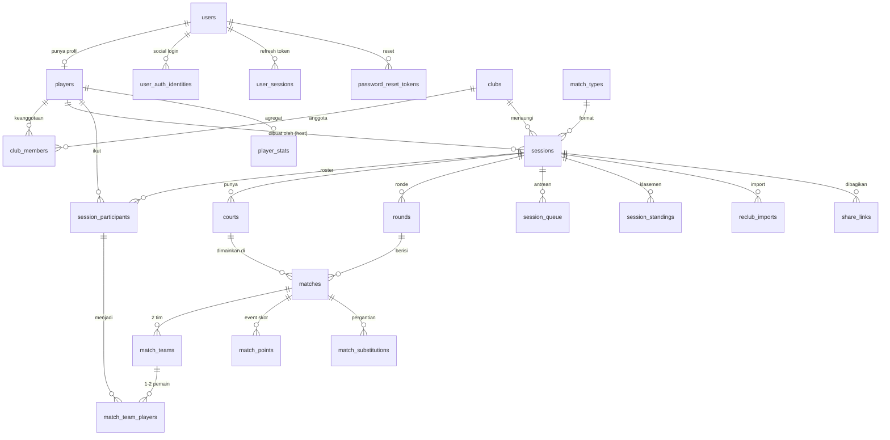

# Rancangan Desain Database — Padelicious Backend

Dokumen ini merancang skema database untuk backend aplikasi Padelicious, diturunkan
dari domain yang sudah ada di aplikasi Flutter (`lib/models/`, `lib/data/`,
`lib/state/app_state.dart`, dan seluruh layar di `lib/screens/`).

- **DBMS target:** PostgreSQL 14+ (memakai `uuid`, `jsonb`, `citext`, partial index,
  generated column). Bisa diadaptasi ke MySQL 8 dengan sedikit penyesuaian.
- **File DDL:** [schema.sql](schema.sql) — siap dijalankan.
- **Konvensi:** `snake_case`, primary key `uuid` (`gen_random_uuid()`), setiap tabel
  punya `created_at`/`updated_at` (`timestamptz`), soft delete hanya di tabel yang
  memang perlu (`deleted_at`).

---

## 1. Pemetaan Fitur Aplikasi → Data

| Layar / fitur | Sumber di kode | Kebutuhan data |
|---|---|---|
| Login, Register, Forgot password, Social login | `login_screen.dart`, `register_screen.dart`, `forgot_password_screen.dart`, `social_login_button.dart` | `users`, `user_auth_identities`, `password_reset_tokens`, `user_sessions` |
| Profile (24 sessions, 68% win rate, #3 club rank, member since) | `profile_screen.dart` | `players`, agregat dari `session_participants` + `player_stats` |
| Players list & detail (level self-assessed, jumlah sesi, klub yang diikuti) | `players_screen.dart`, `player_detail_screen.dart`, `PlayerProfile` | `players`, `club_members` |
| Clubs list, join/leave, create club, member list + owner | `clubs_screen.dart`, `create_club_screen.dart`, `club_detail_screen.dart`, `ClubRepository` | `clubs`, `club_members` (dengan `role`) |
| Setup session (nama, tanggal, tipe match, jumlah court, scoring, golden point, sort leaderboard) | `setup_screen.dart`, `AppState` setup fields, `match_config.dart` | `sessions` + referensi `match_types` |
| Import pemain dari Reclub via match code | `reclub_import_service.dart`, `AppState.fetchReclubImport` | `reclub_imports`, `session_participants.source` |
| Daftar pemain sesi (`setupPlayers`, badge Admin, "via Reclub") | `setup_screen.dart` | `session_participants` |
| Live session: court card, court 1 & 2, status LIVE/FINISHED | `kotc_screen.dart` | `courts`, `rounds`, `matches` |
| Tim kiri/kanan (Iqbal/Rafi vs Budi/Hendra) | `kotc_screen.dart` | `match_teams`, `match_team_players` |
| Scoreboard: games, points 0/15/30/40/GP, serving, undo | `score_screen.dart`, `AppState.scorePoint/undoPoint` | `match_points` (event log, undo = hapus event terakhir), `matches` (state ringkas) |
| Waiting queue + switch player | `kotc_screen.dart`, `MockData.queueNames`, `showSwitchPlayerSheet` | `session_queue`, `match_substitutions` |
| Generate next session / rotasi tim | `kotc_screen.dart` "Generate next session" | `rounds` (round berikutnya) |
| Leaderboard (points, 8W · 2L · 83% WR, podium) | `leaderboard_screen.dart` | `session_standings` (materialized per sesi) |
| Sessions Active/Past + ikon & detail | `sessions_screen.dart`, `SessionSummary` | `sessions.status`, `sessions.icon` |
| Share session / share results (link otomatis) | `kotc_screen.dart`, `setup_screen.dart` | `share_links` |
| Warna avatar/klub (`bg`, `color`, `emoji`) | `mock_data.dart`, `app_colors.dart` | kolom `avatar_color_index` / `emoji` / `theme_color` |

---

## 2. Entity Relationship Diagram



---

## 3. Rancangan Tabel

### 3.1 Identitas & Autentikasi

#### `users`
Akun login. Dipisah dari `players` agar identitas (kredensial) tidak tercampur
dengan profil olahraga — memudahkan penambahan akun non-pemain (admin klub,
organizer) dan pemain tamu tanpa akun.

| Kolom | Tipe | Keterangan |
|---|---|---|
| `id` | `uuid` PK | |
| `email` | `citext` UNIQUE NOT NULL | dipakai login (`validateEmail`) |
| `email_verified_at` | `timestamptz` NULL | |
| `password_hash` | `text` NULL | NULL bila akun murni social login |
| `full_name` | `text` NOT NULL | dari form register |
| `phone` | `text` NULL | |
| `status` | `user_status` | `active`, `suspended`, `deleted` |
| `accepted_terms_at` | `timestamptz` NULL | checkbox "Club Rules and Terms" |
| `last_login_at` | `timestamptz` NULL | |
| `created_at`, `updated_at` | `timestamptz` | `created_at` menjadi "Member since 2024" |

#### `user_auth_identities`
Google/Apple/Facebook login. Satu user bisa punya banyak provider.

| Kolom | Tipe | Keterangan |
|---|---|---|
| `id` | `uuid` PK | |
| `user_id` | `uuid` FK → users ON DELETE CASCADE | |
| `provider` | `auth_provider` | `google`, `apple`, `facebook`, `reclub` |
| `provider_user_id` | `text` NOT NULL | |
| `email` | `citext` NULL | |
| `raw_profile` | `jsonb` NULL | payload mentah provider |
| | UNIQUE `(provider, provider_user_id)` | |

#### `user_sessions`
Refresh token / device session. Mendukung checkbox "Remember me".

| Kolom | Tipe | Keterangan |
|---|---|---|
| `id` | `uuid` PK | |
| `user_id` | `uuid` FK → users | |
| `refresh_token_hash` | `text` UNIQUE NOT NULL | **simpan hash**, bukan token mentah |
| `device_name`, `user_agent`, `ip_address` | `text` / `inet` | audit |
| `remember_me` | `boolean` DEFAULT false | menentukan masa berlaku |
| `expires_at` | `timestamptz` NOT NULL | |
| `revoked_at` | `timestamptz` NULL | logout |

#### `password_reset_tokens`

| Kolom | Tipe | Keterangan |
|---|---|---|
| `id` | `uuid` PK | |
| `user_id` | `uuid` FK → users | |
| `token_hash` | `text` UNIQUE NOT NULL | |
| `expires_at` | `timestamptz` NOT NULL | umumnya 1 jam |
| `used_at` | `timestamptz` NULL | sekali pakai |

---

### 3.2 Pemain & Klub

#### `players`
Profil pemain. `user_id` nullable supaya pemain hasil import Reclub atau pemain
tamu yang ditambah manual ("+ Add player manually") tetap bisa masuk roster dan
dihitung di leaderboard tanpa harus membuat akun.

| Kolom | Tipe | Keterangan |
|---|---|---|
| `id` | `uuid` PK | |
| `user_id` | `uuid` UNIQUE NULL FK → users | NULL = pemain tamu |
| `display_name` | `text` NOT NULL | "Iqbal" |
| `initials` | `char(2)` NOT NULL | "IQ" — di-generate bila kosong |
| `avatar_url` | `text` NULL | foto dari Reclub |
| `avatar_color_index` | `smallint` DEFAULT 0 | indeks ke `AppColors.chipPairs*` (0–7) — warna sebagai data, bukan hex, agar tema app bisa berubah |
| `skill_level` | `numeric(2,1)` NULL | 1.0–5.0 (`reclubLevelValues`) |
| `skill_level_label` | `text` NULL | "Intermediate" — denormalisasi untuk tampilan |
| `gender` | `player_gender` NULL | dibutuhkan Mix Americano / Mixicano |
| `is_guest` | `boolean` GENERATED `(user_id IS NULL)` | |
| `created_at`, `updated_at` | `timestamptz` | |

> **Catatan mix format:** `mix_americano` dan `mixicano` memasangkan pemain
> berdasarkan gender, jadi `gender` wajib ada meski app saat ini belum memakainya.

#### `clubs`

| Kolom | Tipe | Keterangan |
|---|---|---|
| `id` | `uuid` PK | |
| `slug` | `text` UNIQUE NOT NULL | "padel-prime" — id yang dipakai app sekarang |
| `name` | `text` NOT NULL | |
| `emoji` | `text` NOT NULL DEFAULT '🎾' | |
| `theme_color` | `text` NULL | hex latar kartu klub |
| `description` | `text` NOT NULL DEFAULT '' | |
| `city` | `text` NULL | "12 cities" pada Mega Padel League |
| `visibility` | `club_visibility` | `public`, `private`, `invite_only` |
| `owner_player_id` | `uuid` FK → players | pembuat klub |
| `member_count` | `integer` NOT NULL DEFAULT 0 | **counter cache**, di-maintain trigger — `clubs_screen` menampilkannya di daftar, mahal bila `COUNT(*)` tiap baris |
| `created_at`, `updated_at`, `deleted_at` | `timestamptz` | |

#### `club_members`

| Kolom | Tipe | Keterangan |
|---|---|---|
| `club_id` | `uuid` FK → clubs ON DELETE CASCADE | |
| `player_id` | `uuid` FK → players ON DELETE CASCADE | |
| `role` | `club_role` | `owner`, `admin`, `member` — `ClubMember.isOwner` |
| `status` | `membership_status` | `active`, `pending`, `left`, `banned` |
| `joined_at` | `timestamptz` | |
| `left_at` | `timestamptz` NULL | join/leave punya jejak historis |
| | PK `(club_id, player_id)` | |

> `leaveClub` sebaiknya set `status='left'` + `left_at`, bukan DELETE, agar
> riwayat sesi lama tetap konsisten dan rejoin bisa dilacak.

---

### 3.3 Sesi & Konfigurasi Match

#### `match_types` (tabel referensi)
Isi dari `matchTypeGroups` / `matchTypeLabels`. Dibuat sebagai tabel (bukan enum)
supaya format baru bisa ditambah tanpa migrasi enum.

| Kolom | Tipe | Keterangan |
|---|---|---|
| `code` | `text` PK | `americano`, `team_americano`, `mix_americano`, `mexicano`, `team_mexicano`, `mixicano`, `koth`, `team_koth`, `club_team_americano`, `club_americano`, `club_mexicano` |
| `label` | `text` NOT NULL | "King of the Court" |
| `category` | `text` NOT NULL | `Americano`, `Mexicano`, `KOTH`, `Club` |
| `is_team_based` | `boolean` | tim tetap vs rotasi pasangan |
| `is_mixed` | `boolean` | butuh gender |
| `requires_club` | `boolean` | varian `club_*` |
| `sort_order` | `smallint` | urutan di dropdown |

#### `sessions`
Satu sesi bermain = satu baris. Semua field form Setup ada di sini.

| Kolom | Tipe | Keterangan |
|---|---|---|
| `id` | `uuid` PK | |
| `club_id` | `uuid` NULL FK → clubs | NULL untuk sesi pribadi |
| `host_player_id` | `uuid` NOT NULL FK → players | pembuat sesi |
| `name` | `text` NOT NULL | "Sunday King of the Court" |
| `icon` | `text` DEFAULT '🎾' | `SessionSummary.icon` |
| `match_type_code` | `text` NOT NULL FK → match_types | |
| `scheduled_date` | `date` NOT NULL | `matchDate` |
| `court_count` | `smallint` NOT NULL CHECK BETWEEN 1 AND 4 | stepper dibatasi 1–4 |
| `scoring_type` | `scoring_type` NOT NULL | `normal`, `tennis` |
| `points_target` | `smallint` NULL | 16/21/24/32, NULL = "undefined" |
| `tennis_mode` | `tennis_mode` NULL | `race3`..`race7`, `total3`..`total7`, NULL = undefined |
| `golden_point` | `boolean` NOT NULL DEFAULT true | |
| `leaderboard_sort` | `leaderboard_sort` NOT NULL DEFAULT 'points' | `points`, `wins` |
| `status` | `session_status` NOT NULL DEFAULT 'draft' | `draft`, `active`, `completed`, `cancelled` |
| `started_at`, `completed_at` | `timestamptz` NULL | |
| `created_at`, `updated_at` | `timestamptz` | |

**Constraint konsistensi scoring** (mencegah kombinasi ilegal):

```sql
CHECK (
  (scoring_type = 'normal' AND tennis_mode IS NULL)
  OR
  (scoring_type = 'tennis' AND points_target IS NULL)
)
```

#### `session_participants`
Roster pemain pada satu sesi. Menyimpan snapshot nama/avatar agar tampilan sesi
lama tidak berubah kalau pemain mengganti nama belakangan.

| Kolom | Tipe | Keterangan |
|---|---|---|
| `id` | `uuid` PK | |
| `session_id` | `uuid` FK → sessions ON DELETE CASCADE | |
| `player_id` | `uuid` FK → players | |
| `display_name_snapshot` | `text` NOT NULL | |
| `initials_snapshot` | `char(2)` NOT NULL | |
| `avatar_color_index_snapshot` | `smallint` | |
| `role` | `participant_role` | `host`, `admin`, `player` — badge "Admin" |
| `source` | `participant_source` | `manual`, `club`, `reclub` — badge "via Reclub" |
| `status` | `participant_status` | `active`, `queued`, `withdrawn` |
| `joined_at` | `timestamptz` | |
| | UNIQUE `(session_id, player_id)` | |

#### `courts`

| Kolom | Tipe | Keterangan |
|---|---|---|
| `id` | `uuid` PK | |
| `session_id` | `uuid` FK → sessions ON DELETE CASCADE | |
| `court_number` | `smallint` NOT NULL | 1..court_count |
| `label` | `text` NULL | "Court 1" |
| | UNIQUE `(session_id, court_number)` | |

#### `session_queue`
Waiting queue KOTC (`MockData.queueNames`, "8 waiting").

| Kolom | Tipe | Keterangan |
|---|---|---|
| `id` | `uuid` PK | |
| `session_id` | `uuid` FK → sessions ON DELETE CASCADE | |
| `participant_id` | `uuid` FK → session_participants ON DELETE CASCADE | |
| `position` | `integer` NOT NULL | urutan tampil |
| `enqueued_at` | `timestamptz` | |
| `dequeued_at` | `timestamptz` NULL | keluar antrean saat masuk court |
| | UNIQUE `(session_id, position)` DEFERRABLE | reorder butuh deferred agar swap posisi tidak gagal |

---

### 3.4 Ronde, Match, dan Skor

#### `rounds`
Satu klik "Generate next session" = satu ronde baru berisi beberapa match
(satu per court).

| Kolom | Tipe | Keterangan |
|---|---|---|
| `id` | `uuid` PK | |
| `session_id` | `uuid` FK → sessions ON DELETE CASCADE | |
| `round_number` | `integer` NOT NULL | "Game 5" |
| `status` | `round_status` | `pending`, `in_progress`, `completed` |
| `generated_at`, `completed_at` | `timestamptz` | |
| | UNIQUE `(session_id, round_number)` | |

#### `matches`
Satu pertandingan di satu court dalam satu ronde. Menyimpan **state ringkas**
scoreboard supaya pembacaan live cepat (tidak perlu replay seluruh event).

| Kolom | Tipe | Keterangan |
|---|---|---|
| `id` | `uuid` PK | |
| `round_id` | `uuid` FK → rounds ON DELETE CASCADE | |
| `court_id` | `uuid` FK → courts | |
| `status` | `match_status` | `scheduled`, `live`, `finished`, `abandoned` — badge LIVE/FINISHED |
| `games_a`, `games_b` | `smallint` NOT NULL DEFAULT 0 | skor besar ("5–3") |
| `points_a`, `points_b` | `text` NOT NULL DEFAULT '0' | `0/15/30/40/GP` atau angka untuk point scoring |
| `serving_team` | `team_side` NULL | `a` / `b` |
| `winner_team` | `team_side` NULL | diisi saat `finished` |
| `started_at`, `finished_at` | `timestamptz` NULL | |
| | UNIQUE `(round_id, court_id)` | satu court satu match per ronde |

#### `match_teams`

| Kolom | Tipe | Keterangan |
|---|---|---|
| `id` | `uuid` PK | |
| `match_id` | `uuid` FK → matches ON DELETE CASCADE | |
| `side` | `team_side` NOT NULL | `a` (kiri) / `b` (kanan) |
| `score_points` | `integer` NOT NULL DEFAULT 0 | total poin untuk format Americano/Mexicano |
| | UNIQUE `(match_id, side)` | |

#### `match_team_players`

| Kolom | Tipe | Keterangan |
|---|---|---|
| `match_team_id` | `uuid` FK → match_teams ON DELETE CASCADE | |
| `participant_id` | `uuid` FK → session_participants | |
| `slot` | `smallint` NOT NULL CHECK IN (1,2) | padel = 2 pemain/tim |
| | PK `(match_team_id, slot)` | |
| | UNIQUE `(match_team_id, participant_id)` | pemain tidak dobel di satu tim |

#### `match_points` — event log skor
Inti dari `scorePoint` / `undoPoint`. Menyimpan **event**, bukan hanya state akhir:
undo = hapus (atau tandai `voided_at`) event terakhir, lalu state di `matches`
dihitung ulang. Ini juga memberi riwayat poin untuk audit dan replay.

| Kolom | Tipe | Keterangan |
|---|---|---|
| `id` | `uuid` PK | |
| `match_id` | `uuid` FK → matches ON DELETE CASCADE | |
| `sequence` | `integer` NOT NULL | urutan event, 1..n |
| `scoring_team` | `team_side` NOT NULL | |
| `serving_team` | `team_side` NULL | siapa yang servis saat poin itu |
| `points_a_before`, `points_b_before` | `text` | snapshot sebelum — undo jadi O(1) tanpa replay |
| `games_a_before`, `games_b_before` | `smallint` | |
| `is_game_point` | `boolean` DEFAULT false | poin yang menutup game |
| `is_golden_point` | `boolean` DEFAULT false | deuce diselesaikan golden point |
| `recorded_by_player_id` | `uuid` NULL FK → players | siapa yang mencatat (scorer) |
| `recorded_at` | `timestamptz` | |
| `voided_at` | `timestamptz` NULL | hasil undo (soft, agar audit tetap ada) |
| | UNIQUE `(match_id, sequence)` | |

> **Kenapa event log:** `AppState` menyimpan `_history` snapshot di memori untuk
> undo. Di backend, memori itu harus persisten dan multi-device — beberapa orang
> bisa mencatat skor pada match yang sama, dan `sequence` unik memberi
> optimistic concurrency: client mengirim `expected_sequence`, server menolak bila
> sudah berubah.

#### `match_substitutions`
"Switch player" — ganti pemain di court dengan pemain dari antrean.

| Kolom | Tipe | Keterangan |
|---|---|---|
| `id` | `uuid` PK | |
| `match_id` | `uuid` FK → matches ON DELETE CASCADE | |
| `match_team_id` | `uuid` FK → match_teams | |
| `slot` | `smallint` | posisi yang diganti |
| `out_participant_id` | `uuid` FK → session_participants | |
| `in_participant_id` | `uuid` FK → session_participants | |
| `at_sequence` | `integer` NULL | terjadi setelah poin ke-n |
| `created_at` | `timestamptz` | |

---

### 3.5 Klasemen & Statistik

#### `session_standings`
Leaderboard per sesi (points, W/L, win rate, rank, podium). Disimpan sebagai
tabel turunan yang di-*recompute* saat match selesai — query leaderboard jadi
satu `SELECT ... ORDER BY rank` alih-alih agregasi berat tiap kali dibuka.

| Kolom | Tipe | Keterangan |
|---|---|---|
| `session_id` | `uuid` FK → sessions ON DELETE CASCADE | |
| `participant_id` | `uuid` FK → session_participants ON DELETE CASCADE | |
| `points` | `integer` NOT NULL DEFAULT 0 | "42 pts" |
| `wins`, `losses`, `draws` | `integer` NOT NULL DEFAULT 0 | "8W · 2L" |
| `matches_played` | `integer` NOT NULL DEFAULT 0 | |
| `games_won`, `games_lost` | `integer` NOT NULL DEFAULT 0 | |
| `win_rate` | `numeric(5,2)` GENERATED | `wins * 100 / NULLIF(matches_played,0)` → "83% WR" |
| `rank` | `integer` NULL | 1,2,3 untuk podium |
| `updated_at` | `timestamptz` | |
| | PK `(session_id, participant_id)` | |

#### `player_stats`
Agregat lintas-sesi untuk Profile ("24 SESSIONS", "68% WIN RATE") dan
`PlayerProfile.sessions`.

| Kolom | Tipe | Keterangan |
|---|---|---|
| `player_id` | `uuid` PK FK → players | |
| `sessions_played` | `integer` DEFAULT 0 | |
| `matches_played`, `matches_won`, `matches_lost` | `integer` DEFAULT 0 | |
| `total_points` | `integer` DEFAULT 0 | |
| `win_rate` | `numeric(5,2)` GENERATED | |
| `last_played_at` | `timestamptz` NULL | |
| `updated_at` | `timestamptz` | |

> "#3 CLUB RANK" dihitung on-demand dengan window function atas `player_stats`
> ∩ `club_members`, atau dimaterialisasi ke `club_leaderboard` bila klub besar
> (Mega Padel League = 1000 anggota).

---

### 3.6 Integrasi & Sharing

#### `reclub_imports`
Jejak `importByMatchCode` — berguna untuk retry, debugging, dan menghindari
import ganda.

| Kolom | Tipe | Keterangan |
|---|---|---|
| `id` | `uuid` PK | |
| `session_id` | `uuid` NULL FK → sessions ON DELETE SET NULL | |
| `requested_by_player_id` | `uuid` FK → players | |
| `match_code` | `text` NOT NULL | "RC-8421" |
| `status` | `import_status` | `pending`, `success`, `failed` |
| `imported_count` | `integer` DEFAULT 0 | |
| `error_message` | `text` NULL | "Enter a match code" / error API |
| `raw_response` | `jsonb` NULL | payload mentah untuk audit |
| `created_at`, `completed_at` | `timestamptz` | |

#### `share_links`
"A shareable link will be created automatically", share session / share results.

| Kolom | Tipe | Keterangan |
|---|---|---|
| `id` | `uuid` PK | |
| `token` | `text` UNIQUE NOT NULL | slug pendek di URL publik |
| `resource_type` | `share_resource` | `session`, `leaderboard`, `match` |
| `session_id` | `uuid` NULL FK → sessions ON DELETE CASCADE | |
| `match_id` | `uuid` NULL FK → matches ON DELETE CASCADE | |
| `access` | `share_access` | `view`, `score` — link "Score" memberi izin mencatat |
| `created_by_player_id` | `uuid` FK → players | |
| `expires_at` | `timestamptz` NULL | |
| `revoked_at` | `timestamptz` NULL | |
| `view_count` | `integer` DEFAULT 0 | |

---

## 4. Indeks yang Direkomendasikan

```sql
-- Daftar sesi per status (tab Active / Past)
CREATE INDEX idx_sessions_status_date   ON sessions (status, scheduled_date DESC);
CREATE INDEX idx_sessions_club          ON sessions (club_id, scheduled_date DESC);
CREATE INDEX idx_sessions_host          ON sessions (host_player_id, scheduled_date DESC);

-- Roster & "sesi yang saya ikuti"
CREATE INDEX idx_participants_player    ON session_participants (player_id);
CREATE INDEX idx_participants_session   ON session_participants (session_id, status);

-- Klub & anggota aktif (search by name di club_detail)
CREATE INDEX idx_club_members_player    ON club_members (player_id) WHERE status = 'active';
CREATE INDEX idx_clubs_name_trgm        ON clubs USING gin (name gin_trgm_ops);
CREATE INDEX idx_players_name_trgm      ON players USING gin (display_name gin_trgm_ops);

-- Live scoring
CREATE INDEX idx_matches_round          ON matches (round_id);
CREATE INDEX idx_matches_live           ON matches (status) WHERE status = 'live';
CREATE INDEX idx_match_points_match_seq ON match_points (match_id, sequence DESC);

-- Antrean
CREATE INDEX idx_queue_active           ON session_queue (session_id, position) WHERE dequeued_at IS NULL;

-- Leaderboard
CREATE INDEX idx_standings_rank         ON session_standings (session_id, rank);
```

Index trigram (`pg_trgm`) dipakai karena pencarian klub dan anggota di app memakai
*contains* (`name.toLowerCase().contains(q)`), yang tidak bisa memanfaatkan B-tree.

---

## 5. Keputusan Desain Penting

1. **`users` dipisah dari `players`.** Pemain hasil import Reclub dan pemain tamu
   tidak punya akun, tapi tetap perlu masuk roster dan leaderboard. Menggabungkan
   keduanya memaksa pembuatan akun palsu berisi email dummy.

2. **Skor sebagai event log (`match_points`), bukan hanya kolom state.** Undo,
   audit, dan multi-scorer semuanya butuh riwayat. Kolom ringkas di `matches`
   tetap ada sebagai *read model* agar tampilan live tidak perlu agregasi.

3. **`match_types` sebagai tabel referensi, bukan enum.** 11 format sudah ada dan
   varian baru (mis. format klub kustom) kemungkinan besar bertambah; menambah
   baris jauh lebih murah daripada `ALTER TYPE`.

4. **Snapshot nama/avatar di `session_participants`.** Leaderboard sesi lama harus
   menampilkan data seperti saat sesi berlangsung, tidak ikut berubah bila pemain
   mengganti nama.

5. **Warna disimpan sebagai indeks palet, bukan hex.** App menurunkan warna dari
   `AppColors.chipPairs*`; menyimpan indeks membuat perubahan tema tidak
   memerlukan migrasi data.

6. **`session_standings` dimaterialisasi.** Leaderboard dibuka sangat sering dan
   dihitung dari `match_points` × `match_team_players`; menghitungnya on-the-fly
   akan lambat untuk sesi panjang. Recompute dipicu saat match berstatus
   `finished`.

7. **Counter cache `clubs.member_count`.** Daftar klub menampilkan jumlah anggota
   untuk setiap baris; `COUNT(*)` per baris adalah N+1 query klasik.

8. **Join/leave klub memakai status, bukan DELETE.** Menjaga integritas riwayat
   sesi dan memungkinkan analitik churn.

---

## 6. Contoh Query Utama

**Daftar sesi aktif milik seorang pemain** (`sessions_screen`, tab Active):

```sql
SELECT s.id, s.name, s.icon, s.scheduled_date,
       mt.label AS match_type_label,
       COUNT(sp.id) AS player_count
FROM sessions s
JOIN match_types mt ON mt.code = s.match_type_code
JOIN session_participants sp ON sp.session_id = s.id
WHERE s.status = 'active'
  AND EXISTS (
    SELECT 1 FROM session_participants me
    WHERE me.session_id = s.id AND me.player_id = $1
  )
GROUP BY s.id, mt.label
ORDER BY s.scheduled_date DESC;
```

**Leaderboard sesi** (`leaderboard_screen`, menghormati `leaderboard_sort`):

```sql
SELECT ss.rank, sp.display_name_snapshot, sp.initials_snapshot,
       sp.avatar_color_index_snapshot,
       ss.points, ss.wins, ss.losses, ss.win_rate
FROM session_standings ss
JOIN session_participants sp ON sp.id = ss.participant_id
WHERE ss.session_id = $1
ORDER BY
  CASE WHEN $2 = 'wins' THEN ss.wins ELSE ss.points END DESC,
  ss.points DESC;
```

**State live semua court dalam satu sesi** (`kotc_screen`):

```sql
SELECT c.court_number, m.id AS match_id, m.status,
       m.games_a, m.games_b, m.points_a, m.points_b, m.serving_team,
       jsonb_object_agg(mtm.side, mtm.players) AS teams
FROM matches m
JOIN courts c ON c.id = m.court_id
JOIN rounds r ON r.id = m.round_id
JOIN LATERAL (
  SELECT t.side,
         jsonb_agg(sp.display_name_snapshot ORDER BY mtp.slot) AS players
  FROM match_teams t
  JOIN match_team_players mtp ON mtp.match_team_id = t.id
  JOIN session_participants sp ON sp.id = mtp.participant_id
  WHERE t.match_id = m.id
  GROUP BY t.side
) mtm ON true
WHERE r.session_id = $1
  AND r.round_number = (SELECT MAX(round_number) FROM rounds WHERE session_id = $1)
GROUP BY c.court_number, m.id;
```

**Undo poin terakhir** (transaksional, mengembalikan state dari snapshot):

```sql
WITH last_point AS (
  SELECT * FROM match_points
  WHERE match_id = $1 AND voided_at IS NULL
  ORDER BY sequence DESC LIMIT 1
  FOR UPDATE
), voided AS (
  UPDATE match_points SET voided_at = now()
  WHERE id = (SELECT id FROM last_point)
  RETURNING *
)
UPDATE matches m
SET games_a = v.games_a_before, games_b = v.games_b_before,
    points_a = v.points_a_before, points_b = v.points_b_before,
    serving_team = v.serving_team, updated_at = now()
FROM voided v
WHERE m.id = $1;
```

---

## 7. Rencana Migrasi dari Mock Data

Urutan seeding agar FK terpenuhi:

1. `match_types` — 11 baris dari `matchTypeLabels` + `matchTypeGroups`.
2. `users` + `players` — dari `MockData.allPlayers` (16 pemain).
3. `clubs` — dari `MockData.seedClubs()` (7 klub, `id` → `slug`).
4. `club_members` — `isMember: true` menjadi baris `active`; indeks 0 → `owner`.
5. `sessions` + `courts` — dari `activeSessions` / `pastSessions`.
6. `session_participants`, `rounds`, `matches`, `match_teams` — data demo KOTC.
7. `session_standings` — dari `_standings` di `leaderboard_screen`.

---

## 8. Catatan Implementasi Backend

- **Transaksi:** pencatatan poin harus `BEGIN; INSERT match_points; UPDATE matches; COMMIT;`
  dengan `SELECT ... FOR UPDATE` pada `matches` untuk mencegah dua scorer menimpa.
- **Realtime:** `kotc_screen` dan `score_screen` menampilkan skor berjalan —
  gunakan WebSocket/SSE dengan `LISTEN/NOTIFY` pada perubahan `matches`.
- **Retensi:** `user_sessions`, `password_reset_tokens`, dan `match_points`
  ber-`voided_at` lama sebaiknya dibersihkan lewat job terjadwal.
- **Partisi:** bila volume besar, `match_points` layak dipartisi per bulan
  berdasarkan `recorded_at`.
- **Timezone:** semua timestamp `timestamptz` (UTC); `sessions.scheduled_date`
  sengaja `date` karena yang ditampilkan adalah tanggal lokal penyelenggaraan.
